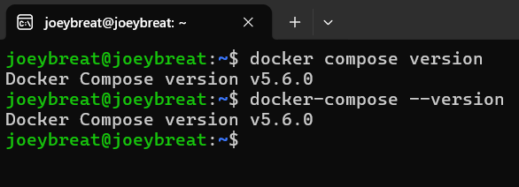
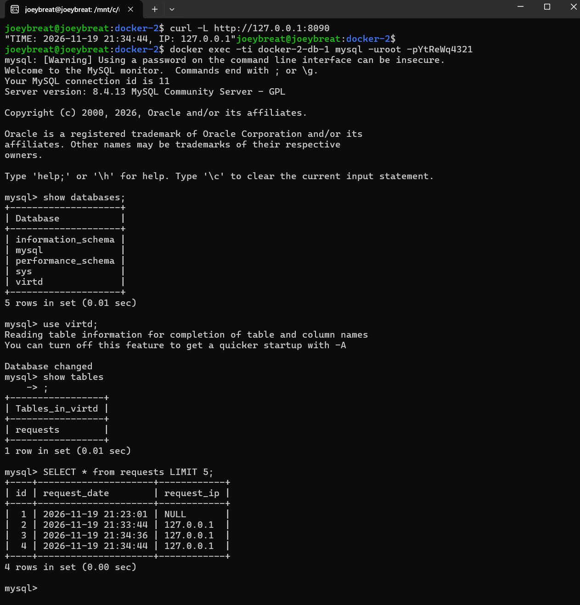
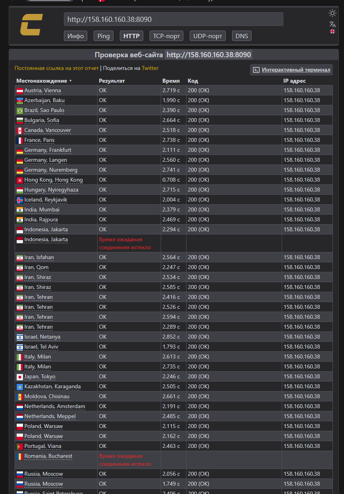
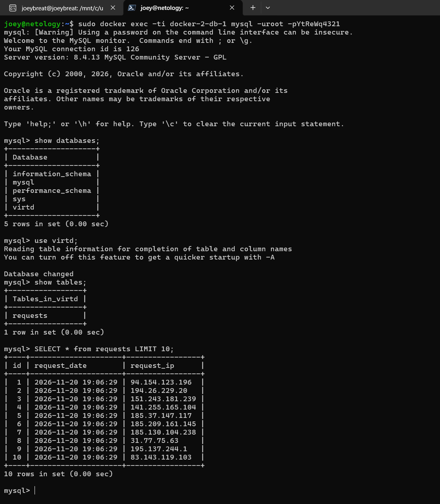
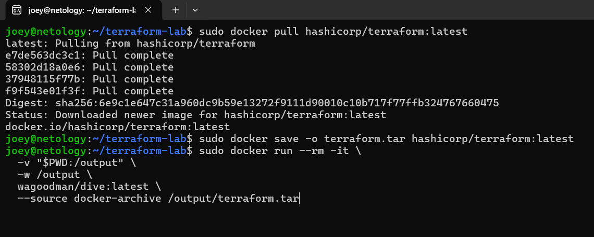
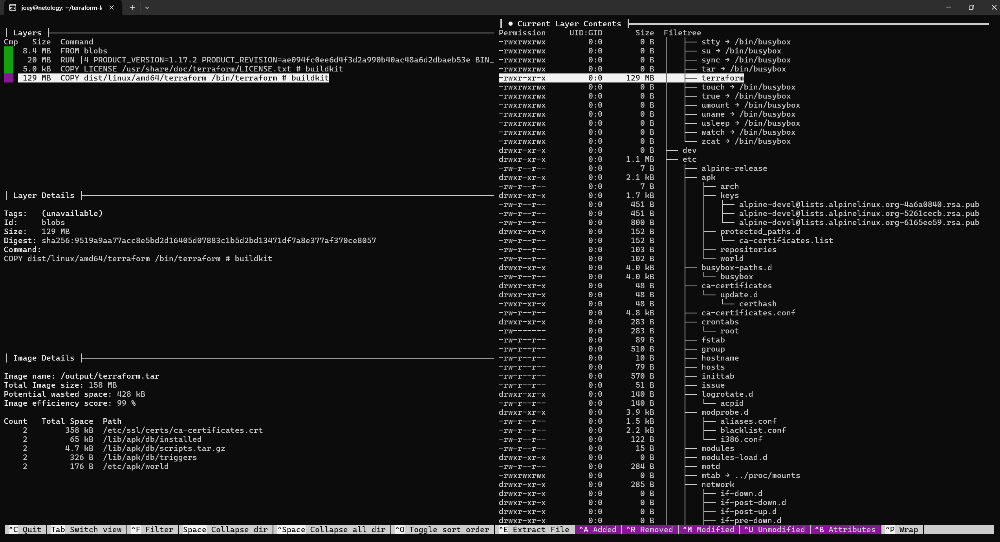
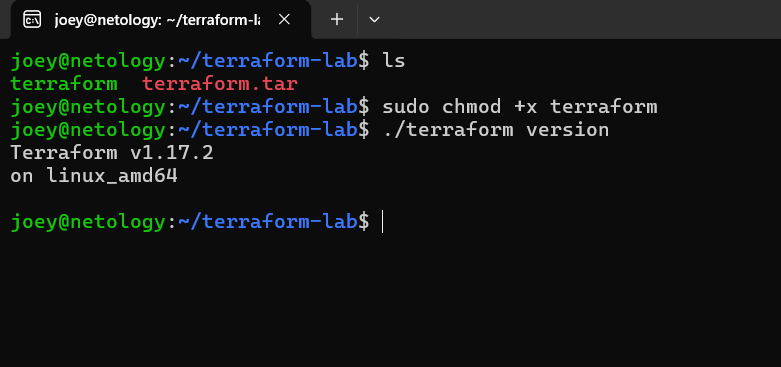

# Домашнее задание к занятию "Практическое применение Docker" - Кобалия Иосиф

### Задание 0

v5.6.0 - версия современного Docker Compose

### Задание 1

В задании не указан формат ответа, так что предоставлю ссылку на свой форк репозитория со всеми пятью файлами (`Dockerfile.python`, `compose.yaml`, `.gitignore`, `.dockerignore` и bash-скрипт `deploy.sh`) - https://github.com/urod2002/docker-2

### Задание 3

Скриншот sql-запроса

### Задание 4

Форк - https://github.com/urod2002/docker-2

Скриншот проверки check-host.net и sql запроса на сервере:

### Задание 6

1. Скачивание образа, сохранение образа в .tar архив и запуск dive в контейнере в соответствии [с инструкцией с github](https://github.com/wagoodman/dive). Также была проброшена текущая папка, чтобы сработал Extract file
   

2. Файл /bin/terraform найден и сохранён
   

   

P.S. Я открыто передаю пароли так как воспринимаю их как учебные, поскольку они также открыто передаются в оригинальном репозитории. С .gitignore и переменными окружения такая же история.
